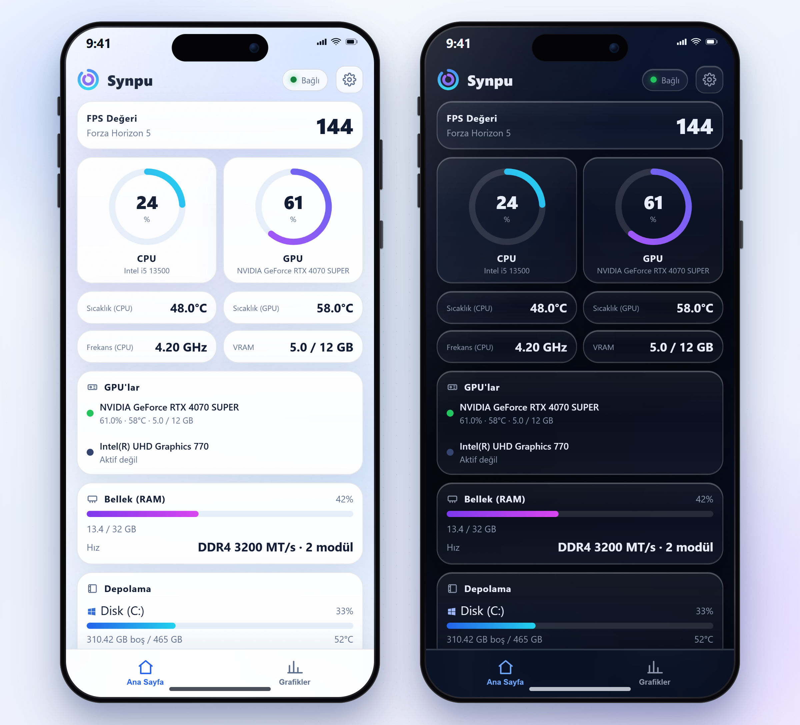

# Synpu

<p align="center">
  
</p>

PC'nin canlı sistem istatistiklerini (CPU/GPU kullanımı ve sıcaklığı, RAM, diskler, ağ, fanlar, oyun FPS) telefonundan takip et. Synpu PC'de arka planda çalışır; aynı Wi-Fi ağındaki telefon tarayıcısından `http://<PC-IP>:8787` adresine bağlanırsın. Kurulum ve hesap gerekmez; veriler yerel ağda kalır. Arayüz cihazın sistem temasına uyar: açık sistemde açık, koyu sistemde koyu görünür.

## Ne gösterir?

| Kart | Değerler |
|------|----------|
| İşlemci | Kullanım %, sıcaklık, frekans, model |
| Ekran Kartı | Kullanım %, sıcaklık + hotspot, fan %, frekans, VRAM, güç; çift GPU'da aktif kart otomatik seçilir |
| Bellek | Kullanılan / toplam, %, DDR tipi + hız (MT/s) + modül sayısı |
| Diskler | Kalan alan, sıcaklık, okuma/yazma hızı, SMART sağlığı + çalışma saati; sistem diski Windows simgeli |
| Ağ | İndirme / yükleme hızı, gecikme, internet sağlayıcı (ISP) ve Wi-Fi adı |
| Sistem | Bilgisayar adı, çalışma süresi, anakart, monitör adı + çözünürlük + Hz |
| Fanlar | Aktif fan devirleri (anakart destekliyorsa, best-effort) |
| FPS / En Yoğun | Ön plandaki uygulamanın FPS'i; en çok CPU/RAM/GPU kullanan süreçler |

Ayrıca **Grafikler** sekmesi 10dk/1sa/12sa/48sa aralıklarında CPU (çekirdek bazlı dahil), GPU, RAM, Ağ ve Disk grafikleri gösterir; geçmiş diske yazılır (PC yeniden başlasa da korunur) ve Ayarlar'dan **CSV** indirilebilir. Değerler 0.1 sn'de bir güncellenir. Uyarı eşikleri: CPU/GPU sıcaklık 70°C sarı / 80°C kırmızı; disk doluluk %85/%95; RAM %90/%97. Okunamayan bir değer `—` olarak görünür.

Ayarlar penceresinden **"Başlangıçta çalıştır"** anahtarı, CSV dışa aktarma ve sürüm/güncelleme durumu yönetilir. Tarayıcı sekmesinde canlı `CPU % · GPU %` başlığı görünür.

## Gereksinimler

- Windows 10/11
- Yönetici izni (CPU sıcaklığı ve FPS için gerekli; kurulum bunu otomatik ayarlar)
- NVIDIA ekran kartı (opsiyonel — yoksa GPU kartı `—` gösterir)
- Telefonla aynı Wi-Fi ağı

## Kurulum

1. `SynpuSetup.exe` dosyasını çalıştır ve UAC onayını ver (depoda: `dist/SynpuSetup.exe`).
2. Kurulum, gerekli bileşenleri internetten indirir (birkaç dakika sürebilir).
3. Masaüstünde **Synpu** simgesi oluşur. Synpu arka planda başlar ve bilgisayar her açıldığında otomatik çalışır — **Görev Yöneticisi → Başlangıç uygulamaları** listesinde "Synpu" olarak görünür ve oradan açılıp kapatılabilir.
4. Telefonla bağlanmak için masaüstündeki **Synpu** simgesine tıkla; QR penceresi açılır (uygulama zaten çalışıyorsa pencere öne getirilir).
5. Telefonda sayfa açılınca çıkan **"Ekle"** uyarısıyla Synpu'yu ana ekrana ekleyebilirsin (destekleyen tarayıcıda tek dokunuş; iOS'ta Paylaş → "Ana Ekrana Ekle").

Kaynaktan kurulum (geliştiriciler için): `setup.bat`.

Kurulum sırasında internetten indirilenler: [uv](https://astral.sh/uv) (Python paket yöneticisi), [PresentMon v2.6.0](https://github.com/GameTechDev/PresentMon) (FPS ölçümü), [LibreHardwareMonitor v0.9.6](https://github.com/LibreHardwareMonitor/LibreHardwareMonitor) (CPU sensörleri) ve [PawnIO v2.2.0](https://pawnio.eu) (imzalı sensör sürücüsü). Kapalı kaynak hiçbir bileşen yoktur.

## Telefonla bağlanma

1. Kurulum sonrası PC'de **"Synpu — Telefonla Bağlan"** penceresi açılır; QR kodu telefonun kamerasıyla okut.
2. Tarayıcı otomatik açılır ve panel görünür; sayfayı aşağı çekerek yenileyebilirsin.
3. Sayfayı ana ekrana ekleyebilirsin (Tarayıcı menüsü → "Ana ekrana ekle") — uygulama gibi açılır (manifest + ikonlar hazır).

Pencereyi kapatırsan Synpu çalışmaya devam eder; sağ alt tepsi simgesinden "QR'ı Göster" ile geri açabilirsin.

## Çoklu PC

Aynı uygulamayı diğer PC'lere de kur. Telefon sayfasındaki **"+ PC ekle"** düğmesiyle diğer PC'nin adresini (`http://192.168.1.50:8787` gibi) ekle; üstteki sekmelerden PC'ler arasında geçiş yap.

## Sorun giderme

- **CPU sıcaklığı / FPS `—` görünüyor:** Uygulama yönetici olarak çalışmıyor olabilir. `Get-ScheduledTask -TaskName Synpu` görevinin çalıştığını kontrol et; kurulum görevi yönetici seviyesinde ayarlar.
- **Telefondan bağlanamıyorum:** Telefon ve PC aynı Wi-Fi'de mi? Ağ profilinin **Özel (Private)** olması gerekir; genel ağda Windows gelen bağlantıları engeller. Güvenlik duvarı kuralı: `Get-NetFirewallRule -DisplayName "Synpu*"`.
- **"Port 8787 kullanımda" hatası:** Synpu zaten çalışıyor olabilir. Farklı port için: `$env:SYNPU_PORT=8788; .venv\Scripts\pythonw.exe -m synpu`
- **GPU değerleri `—`:** NVIDIA sürücüsü yok ya da kart NVIDIA değil.
- **CPU sıcaklığı sabit/düşük görünüyor:** PawnIO sürücüsü eksikse Synpu ACPI bölge sıcaklığına düşer. `Get-Service PawnIO` ile kontrol et; kurulum betiği otomatik kurar. PawnIO'nun imzalı resmi sürümü Bellek Bütünlüğü (Çekirdek Yalıtımı) açıkken de çalışır.
- **Adres değişti:** Modem PC'ye yeni IP verdiyse QR penceresindeki adres güncellenir; telefon sayfasındaki sekmeyi silip yeniden ekle.
- **Telefon bağlanıyor ama sayfa açılmıyor:** Bazı modemlerde "AP isolation / istemci izolasyonu" açıktır; aynı Wi-Fi'deki cihazlar birbirine erişemez. Modem ayarlarından kapatılmalıdır.
- **Güncelleme:** Synpu, GitHub'daki son sürümü günde bir kontrol eder; yeni sürüm varsa Ayarlar → Hakkında bölümünde indirme bağlantısı görünür.

## Kaldırma

**Ayarlar → Uygulamalar → Synpu → Kaldır** (kısayollar, görev ve güvenlik duvarı kuralı otomatik silinir; program dosyaları `%LOCALAPPDATA%\Synpu` altındadır).

Manuel kaldırma (gerekirse):

```powershell
Unregister-ScheduledTask -TaskName Synpu -Confirm:$false
Remove-NetFirewallRule -DisplayName "Synpu (TCP 8787)"
```

## Lisanslar

- Synpu: [MIT](LICENSE)
- [PresentMon](https://github.com/GameTechDev/PresentMon): MIT — metin: `third_party/PresentMon-LICENSE.txt`
- [LibreHardwareMonitor](https://github.com/LibreHardwareMonitor/LibreHardwareMonitor): MPL-2.0 — metin: `third_party/LibreHardwareMonitor-LICENSE.txt`
- [PawnIO](https://pawnio.eu): GPL-2.0 (özel istisnayla) — Synpu ile paketlenmez, kurulum betiği resmi imzalı sürümü indirir — metin/bağlantı: `third_party/PawnIO-NOTICE.txt`
- Python bağımlılıkları (FastAPI, uvicorn, psutil, pythonnet, qrcode, pystray, Pillow): MIT/BSD/Apache-2.0
- Sunucu tarafına kurulan `LibreHardwareMonitorLib.dll`, `PresentMon.exe` ve PawnIO bu depoda değildir; kurulum betiği indirir.

---

## English (short)

Synpu shows live CPU/GPU usage and temperature, RAM, and game FPS of your PC in your phone's browser over the local network — no account, no cloud. The UI follows your system light/dark theme. Requirements: Windows 10/11, admin rights (for CPU temp and FPS). Setup: double-click `setup.bat`, approve UAC, then scan the QR code shown on the PC with your phone (same Wi-Fi). Multi-PC: add other PCs from the "+ PC ekle" button. Uninstall: remove the "Synpu" scheduled task, the "Synpu (TCP 8787)" firewall rule, and the folder. License: MIT.
